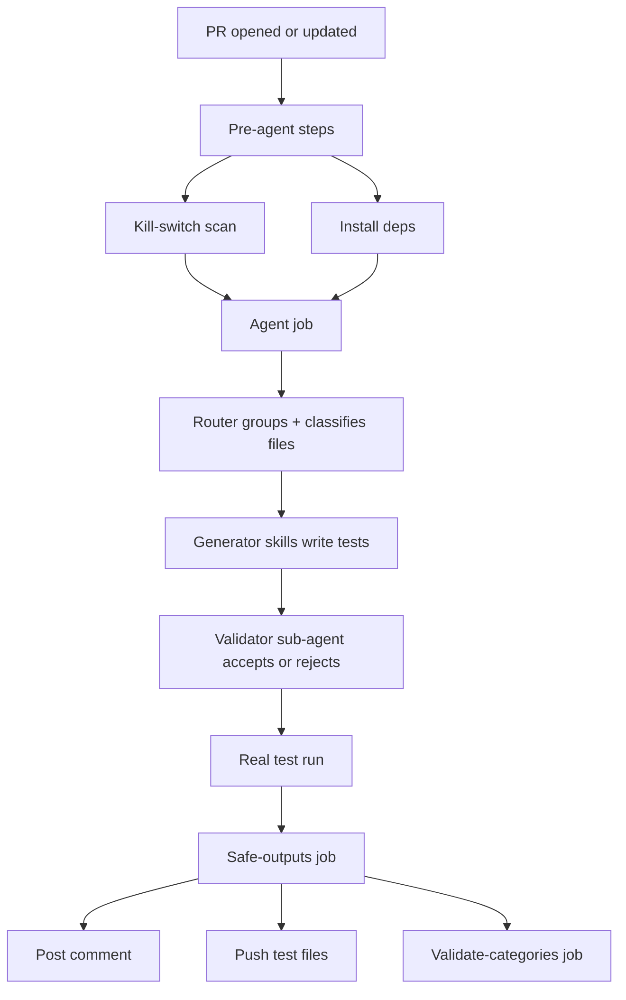
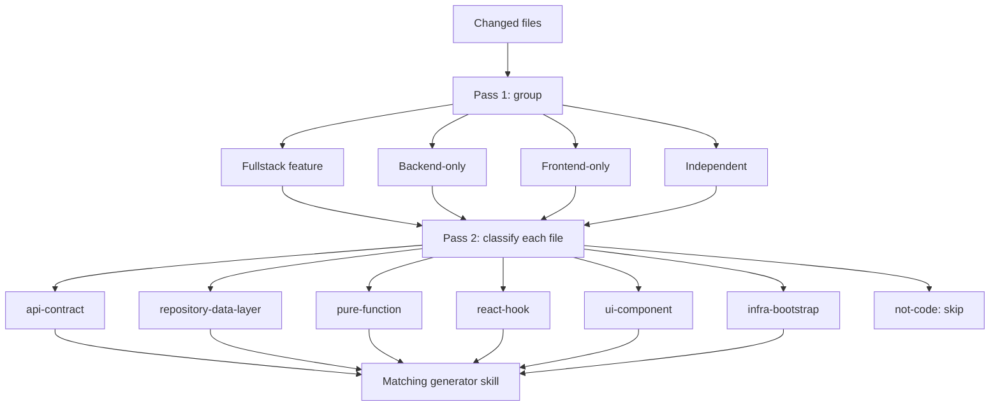

# Solution

Repo: [MichalPerek/cloudfide_assignment](https://github.com/MichalPerek/cloudfide_assignment). Base: [cf-recruitment/taskly-app-node](https://github.com/cf-recruitment/taskly-app-node).

## What this is

A Node/Express/Prisma + React todo app. An agent watches pull requests, writes or updates unit tests for whatever code changed, runs those tests, and reports the result on the PR. Backend and frontend both, no human triggering it.

## Why gh-aw

Chose [GitHub Agentic Workflows](https://github.com/github/gh-aw) over a hand-written Actions workflow calling the Claude Code Action directly:

- It's built for exactly this: watch PRs, run an agent, post results back, instead of wiring that up by hand in raw Actions YAML.
- Good security defaults out of the box: read-only by default, write access split into its own step, network restricted to an allowlist, no config needed.
- Skills and sub-agents are first-class, so "custom agent + reusable skills" maps onto the tool directly.

## How it's put together

- **Agent**: `.github/workflows/pr-test-writer.md`. YAML frontmatter (trigger, permissions, tools, allowed outputs) plus a plain-English prompt.
- `gh aw compile` generates `.github/workflows/pr-test-writer.lock.yml`, which is what Actions actually runs.
- Edit the `.md`, recompile, commit both.

**Skills**: `.claude/skills/*/SKILL.md`.

| Skill | Job |
|---|---|
| `test-strategy-router` | Groups changed files, classifies each one into a test category, decides if a test is needed at all. |
| `api-contract-tests` | Express router tests, supertest, stubbed repository. |
| `repository-tests` | Prisma repository tests, real Prisma client, mocked I/O. |
| `pure-function-tests` | Plain functions: validators, mappers, utilities. No mocking. |
| `react-hook-tests` | Hooks, including TanStack Query hooks under a real `QueryClientProvider`. |
| `ui-component-tests` | Components, RTL, `userEvent`. |
| `infra-smoke-tests` | Bootstrap/wiring code: skip, smoke test, or (for `factory.ts`) a full request-level test. |
| `test-verification-and-reporting` | Writes the final PR comment. |

**Validator**: `.claude/agents/independent-test-validator.md`, a gh-aw sub-agent, not a skill.

- A skill loads into the generator's own conversation.
- A sub-agent gets a fresh context with only the category, diff, and proposed test, no transcript.
- Output is ACCEPT or REJECT with specific reasons tied to its rubric.
- No retry loop: gh-aw runs one engine invocation per job, no matrix/strategy loops. One attempt per file: generate, validate, report plainly if rejected.

## Watching changes and reporting

- `test-strategy-router` groups changed files before classifying them. A backend change and the frontend code that consumes it get reported as one feature, not two unrelated rows. Unrelated changes stay separate, bucketed backend/frontend.
- Each group gets a status badge. The comment ends with exactly one of three fixed, machine-checkable outcomes: `SUCCEEDED`, `FAILED`, `SKIPPED`. A partial pass in a group is reported as `FAILED` for that group.
- Categories are enforced in code, not just in skill prose: `.github/aw/test-categories.json` is the canonical list, and `.github/aw/scripts/validate-test-categories.mjs` runs in its own job after the comment is posted, reads the category names from a marker in it, and fails with the exact bad name(s) if anything doesn't match the manifest. An invented or misspelled category fails the job instead of silently passing.

## Safety

Assuming this stays a public/open repo, PR title/body/diff is attacker-controlled text an LLM reads.

### Repo safety

- `agent` job has no GitHub write access at all (`permissions: {}` plus `contents: read`/`pull-requests: read` only).
- One secret present: `ANTHROPIC_API_KEY`. No GitHub credential anywhere near the agent job.
- GitHub-hosted runners, torn down after each run.
- Fork PRs: `GITHUB_TOKEN` cannot push to a fork's branch, platform behavior, not a setting. Default output is a comment with a suggested patch; direct commit only for same-repo PRs.
- The one write path (`push_to_pull_request_branch`, same-repo only) is restricted to test files in the prompt, and separately blocked from `.github/**`/lockfiles by gh-aw's own `protect_top_level_dot_folders`.
- Workflow instructions, skills, and sub-agent are read from `main`, never the PR branch, so a PR can't rewrite its own rules mid-run.

### Workflow safety

- `.github/aw/scripts/detect-suspicious-pr-content.sh` runs as a `pre-agent-steps` entry, scans PR title/body/diff for known injection phrasing and shell-exec patterns, and aborts before the LLM runs if it matches. Added on top, not the main defense.
- Network access goes through gh-aw's firewall container: LLM API and npm registry only.
- `npm ci --ignore-scripts` on every install. Prisma client generated with its own explicit command, not postinstall.

What this doesn't do:

- Stop a novel or obfuscated injection attempt from reaching the model. The regex only catches known phrasing.
- That's acceptable because the agent has no write access and no useful secret even if fooled. Nothing to steal, nowhere to send it.

## Example run

PR [#9](https://github.com/MichalPerek/cloudfide_assignment/pull/9), "Add clear-completed-todos feature": real feature, backend + frontend, no tests.

| File | Test added | Covers |
|---|---|---|
| `backend/.../repository.ts` | `repository.test.ts` | Returned count, exact Prisma call args, zero-result case. |
| `backend/.../router.ts` | `router.test.ts` | Happy path and zero-cleared case via supertest. |
| `frontend/.../TodosHeader.tsx` | `TodosHeader.test.tsx` | Button hidden/shown correctly, click fires once, disabled state. |
| `frontend/.../useClearCompletedMutation.ts` | `useClearCompletedMutation.test.ts` (new) | Resolved value, list-query invalidation. |
| `frontend/.../api/todos.ts` | skipped | One-line delegation to `request()`, no category fits it. |
| `frontend/.../TodosPage.tsx` handler | skipped | Same pattern as an existing, already-untested handler, covered indirectly by the two tests above. |

4/4 generated tests accepted by the validator on first pass. Backend 51/51, frontend 21/21 passing, pushed to the PR branch.

Separately: fed the validator a deliberately bad test by hand (tautological assertions). It rejected it with itemized reasons, including flagging a possible real bug in the surrounding code that it explicitly said it couldn't confirm without running it.

## Assumptions

- Public repo, for cost/access reasons (free Actions minutes, no collaborator invite needed), not a security choice.
- Reviewer checks this via linked runs and PRs, not by re-running anything.
- New tests gate on "passes and the validator accepts it," not the backend's existing 100% coverage threshold. That threshold is specific to `validators.ts`/`mappers.ts`.

## Limitations / what I'd change for production

- No retry loop: gh-aw limitation, single engine invocation per job. Would need a real multi-job retry across separate workflow invocations.
- No flakiness check: a test that passes once isn't necessarily reliable. Should run new tests a few times with randomized order before trusting them enough to push.
- Category is enforced; test *style* within a category isn't. Nothing lints generated tests against each skill's stated conventions beyond trusting the agent to follow them.
