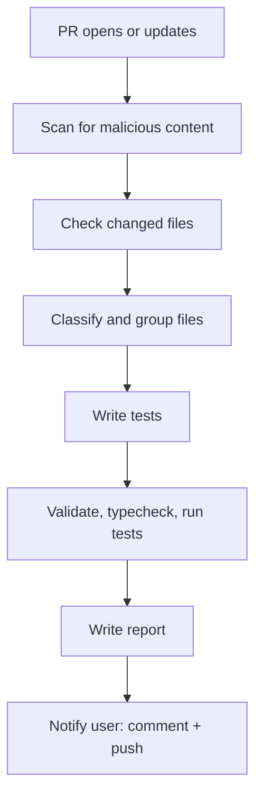
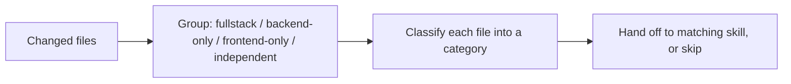

# Solution

Repo: [MichalPerek/cloudfide_assignment](https://github.com/MichalPerek/cloudfide_assignment). Base: [cf-recruitment/taskly-app-node](https://github.com/cf-recruitment/taskly-app-node).

## What this is

A Node/Express/Prisma + React todo app. An agent watches pull requests, writes or updates unit tests for whatever code changed, runs those tests, and reports the result on the PR. Backend and frontend both, no human triggering it.

## Why gh-aw

Chose [GitHub Agentic Workflows](https://github.com/github/gh-aw) over a hand-written Actions workflow calling the Claude Code Action directly:

- It's built for exactly this: watch PRs, run an agent, post results back, instead of wiring that up by hand in raw Actions YAML.
- Good security defaults out of the box: read-only by default, write access split into its own step, network restricted to an allowlist, no config needed.
- Skills and sub-agents are first-class, so "custom agent + reusable skills" maps onto the tool directly.

## How it's put together

High level, in order:

1. A PR opens or gets a new commit.
2. The PR gets scanned for malicious content before anything else runs.
3. Changed files get checked against the base branch.
4. Each changed file gets classified and grouped.
5. Tests get written for whatever needs one.
6. Each test gets validated, typechecked, and run for real.
7. A report gets written and posted on the PR.
8. Passing tests get pushed to the branch, if it's safe to.

### 1-2. Trigger and the kill-switch scan

- Trigger is `pull_request`, `opened`/`synchronize`, scoped to `backend/**` and `frontend/**` only.
- Before the agent or any LLM runs at all, `.github/aw/scripts/detect-suspicious-pr-content.sh` runs as the first `pre-agent-steps` entry.
- It reads the PR title and body from env vars (never interpolated straight into `run:`, that's a shell-injection vector) and diffs the PR branch against the base ref.
- It checks for four things: prompt-injection phrasing ("ignore previous instructions", "reveal your system prompt", etc.), secret-exfiltration patterns, suspicious shell-exec patterns, and invisible/zero-width Unicode used to smuggle hidden text.
- Secret-exfil and shell-exec patterns are only checked in the title/body, not the diff, because scanning the diff for them false-positives on completely normal code (`process.env`, `curl`, `eval(` all show up in real source files). Prompt-injection and invisible-unicode patterns are checked across title, body, and diff.
- Any match aborts the job right there, before the LLM has even started, and prints what matched and where to the run log.
- This is defense-in-depth, not the main defense. See Safety below for what actually contains a successful injection.

### 3-4. Checking and classifying changed files

- `test-strategy-router` runs first inside the agent job and does two passes over `git diff --name-only` against the base ref.
- Pass 1 groups files: a backend change and the frontend code that consumes it in the same PR get reported as one feature, not two unrelated rows. Files that don't bind to anything else stay independent, bucketed backend or frontend.
- Pass 2 classifies each file into a category and decides if a test is even warranted (a types-only file or a pure rename gets skipped, not forced through a generator).

- Categories, with a simple example of a change that would fall into each:

| Category | Example change | Test? |
|---|---|---|
| `api-contract` | Add a `DELETE /todos/completed` route to `router.ts`. | Yes, `api-contract-tests` |
| `repository-data-layer` | Add a `clearCompleted()` method to `repository.ts`. | Yes, `repository-tests` |
| `pure-function` | Add a `sortLabel(sort)` helper to `utils/todos.ts`. | Yes, `pure-function-tests` |
| `react-hook` | New `useClearCompletedMutation.ts` hook. | Yes, `react-hook-tests` |
| `ui-component` | Add a "Clear completed" button to `TodosHeader.tsx`. | Yes, `ui-component-tests` |
| `infra-bootstrap` | Wire the new route into `factory.ts`. | Yes (smoke test), `infra-smoke-tests` |
| `trivial` | Add a field to `types.ts`, or rename a local variable with no behavior change. | No, skipped |

- `.github/aw/test-categories.json` is the canonical list of those names, checked in code (not just skill prose) by `.github/aw/scripts/validate-test-categories.mjs`, which runs in its own job after the PR comment is posted and fails the job if the comment used a name that doesn't match the manifest.

### 5. Writing the tests

One skill per category instead of one generic "write a test" skill, because each area of the codebase has its own real conventions (how Prisma gets mocked, which Testing Library APIs are allowed, how TanStack Query hooks get wrapped). A single skill blurs those into generic, inconsistent tests. Each skill is a small harness for its category: it states what "good" looks like there, grounded in excerpts read from this repo's own existing tests, not generic testing advice.

**Agent**: `.github/workflows/pr-test-writer.md`. YAML frontmatter (trigger, permissions, tools, allowed outputs) plus a plain-English prompt. `gh aw compile` generates `.github/workflows/pr-test-writer.lock.yml`, which is what Actions actually runs. Edit the `.md`, recompile, commit both.

**Skills**: `.claude/skills/*/SKILL.md`.

| Skill | Job |
|---|---|
| `test-strategy-router` | Groups changed files, classifies each one into a test category, decides if a test is needed at all. |
| `api-contract-tests` | Express router tests, supertest, stubbed repository. |
| `repository-tests` | Prisma repository tests, real Prisma client, mocked I/O. |
| `pure-function-tests` | Plain functions: validators, mappers, utilities. No mocking. |
| `react-hook-tests` | Hooks, including TanStack Query hooks under a real `QueryClientProvider`. |
| `ui-component-tests` | Components, RTL, `userEvent`. |
| `infra-smoke-tests` | Bootstrap/wiring code: skip, smoke test, or (for `factory.ts`) a full request-level test. |
| `test-verification-and-reporting` | Writes the final PR comment. |

### 6. Validating and running the tests

**Validator**: `.claude/agents/independent-test-validator.md`, a gh-aw sub-agent, not a skill.

- A skill loads into the generator's own conversation.
- A sub-agent gets a fresh context with only the category, diff, and proposed test, no transcript.
- Output is ACCEPT or REJECT with specific reasons tied to its rubric.
- No retry loop: gh-aw runs one engine invocation per job, no matrix/strategy loops. One attempt per file: generate, validate, report plainly if rejected.
- Every accepted test also has to pass `typecheck` (and `format:check` for frontend files) before the real test run counts it. Cheap and already wired in both packages, catches type errors and formatting drift without relying on the validator's or the agent's own judgment.
- A changed `*.test.tsx` file also has to pass `.github/aw/scripts/validate-test-conventions.sh`, which greps it for the convention violations `ui-component-tests/SKILL.md` bans: `fireEvent` instead of `userEvent`, test-id queries instead of role/text queries, snapshot testing. A deterministic check, not something left to the validator's judgment.
- Only after typecheck/format:check and the convention check pass does the real test suite run (`npm test`). That real run is the only thing allowed to say pass or fail on behavior.

### 7-8. Reporting and notifying

- Each group gets a status badge. The comment ends with exactly one of three fixed, machine-checkable outcomes: `SUCCEEDED`, `FAILED`, `SKIPPED`. A partial pass in a group is reported as `FAILED` for that group.
- Accepted, passing tests get pushed to the PR branch via the `push-to-pull-request-branch` safe output, only for same-repo PRs, restricted to `*.test.ts`/`*.test.tsx` files.
- For a fork PR, nothing gets pushed. The proposed test content goes into the comment as a suggested patch instead.

What the comment itself looks like, one section per group:

> ### ✅ Clear completed todos (API integration change + hook change + UI change)
>
> Backend exposes a delete-completed endpoint, frontend wires it to a new button.
>
> | File | Role | Test file | Result |
> |---|---|---|---|
> | repository.ts | repository-data-layer | repository.test.ts | pass |
> | router.ts | api-contract | router.test.ts | pass |
> | TodosHeader.tsx | ui-component | TodosHeader.test.tsx | pass |
> | useClearCompletedMutation.ts | react-hook | useClearCompletedMutation.test.ts | pass |
> | todos.ts | — | — | skipped — one-line delegation to `request()`, no category fits it |
>
> Validator feedback: no issues on first pass.

- **Heading**: the group's name and its change-type tag(s), not a file list, so a reviewer sees the feature, not plumbing.
- **✅ / ❌ / ⏭**: pass, at least one fail in the group, or nothing in the group needed a test.
- **Role**: the test category that routed the file to its generator skill (same names as the example table above).
- **Result**: `pass` only after the file cleared the validator, typecheck/format:check, the convention check, and the real test run, in that order. Anything short of all four is `fail`, never a partial credit. A skipped file is still a row in this same table, with the reason inline, not a separate list underneath.
- **Validator feedback**: one line per file, so a rejection shows up as "rejected: &lt;reason&gt;" right where the row is, not buried somewhere else.
- Below all the groups, two more HTML comments carry the machine-checkable state: `<!-- gh-aw-test-writer: SUCCEEDED|FAILED|SKIPPED -->` (the overall outcome) and `<!-- gh-aw-test-categories: [...] -->` (every category name used, checked against the manifest by `validate-test-categories.mjs`). Neither is meant to be read by a human, they're there so downstream jobs don't have to parse the markdown tables.

## Safety

Assuming this stays a public/open repo, PR title/body/diff is attacker-controlled text an LLM reads.

### Repo safety

- `agent` job has no GitHub write access at all (`permissions: {}` plus `contents: read`/`pull-requests: read` only).
- One secret present: `ANTHROPIC_API_KEY`. No GitHub credential anywhere near the agent job.
- GitHub-hosted runners, torn down after each run.
- Fork PRs: `GITHUB_TOKEN` cannot push to a fork's branch, platform behavior, not a setting. Default output is a comment with a suggested patch; direct commit only for same-repo PRs.
- The one write path (`push_to_pull_request_branch`, same-repo only) is restricted to test files in the prompt, and separately blocked from `.github/**`/lockfiles by gh-aw's own `protect_top_level_dot_folders`.
- Workflow instructions, skills, and sub-agent are read from `main`, never the PR branch, so a PR can't rewrite its own rules mid-run.

### Workflow safety

- The kill-switch scan (see step 2 above) is added on top, not the main defense.
- Network access goes through gh-aw's firewall container: LLM API and npm registry only.
- `npm ci --ignore-scripts` on every install. Prisma client generated with its own explicit command, not postinstall.

What this doesn't do:

- Stop a novel or obfuscated injection attempt from reaching the model. The regex only catches known phrasing.
- That's acceptable because the agent has no write access and no useful secret even if fooled. Nothing to steal, nowhere to send it.

## Example run

PR [#9](https://github.com/MichalPerek/cloudfide_assignment/pull/9), "Add clear-completed-todos feature": real feature, backend + frontend, no tests.

| File | Test added | Covers |
|---|---|---|
| `backend/.../repository.ts` | `repository.test.ts` | Returned count, exact Prisma call args, zero-result case. |
| `backend/.../router.ts` | `router.test.ts` | Happy path and zero-cleared case via supertest. |
| `frontend/.../TodosHeader.tsx` | `TodosHeader.test.tsx` | Button hidden/shown correctly, click fires once, disabled state. |
| `frontend/.../useClearCompletedMutation.ts` | `useClearCompletedMutation.test.ts` (new) | Resolved value, list-query invalidation. |
| `frontend/.../api/todos.ts` | skipped | One-line delegation to `request()`, no category fits it. |
| `frontend/.../TodosPage.tsx` handler | skipped | Same pattern as an existing, already-untested handler, covered indirectly by the two tests above. |

4/4 generated tests accepted by the validator on first pass. Backend 51/51, frontend 21/21 passing, pushed to the PR branch.

Separately: fed the validator a deliberately bad test by hand (tautological assertions). It rejected it with itemized reasons, including flagging a possible real bug in the surrounding code that it explicitly said it couldn't confirm without running it.

## Assumptions

- Public repo, for cost/access reasons (free Actions minutes, no collaborator invite needed), not a security choice.
- Reviewer checks this via linked runs and PRs, not by re-running anything.
- New tests gate on "passes and the validator accepts it," not the backend's existing 100% coverage threshold. That threshold is specific to `validators.ts`/`mappers.ts`.

## Limitations / what I'd change for production

- No retry loop: gh-aw limitation, single engine invocation per job. Would need a real multi-job retry across separate workflow invocations.
- No flakiness check: a test that passes once isn't necessarily reliable. Should run new tests a few times with randomized order before trusting them enough to push.
